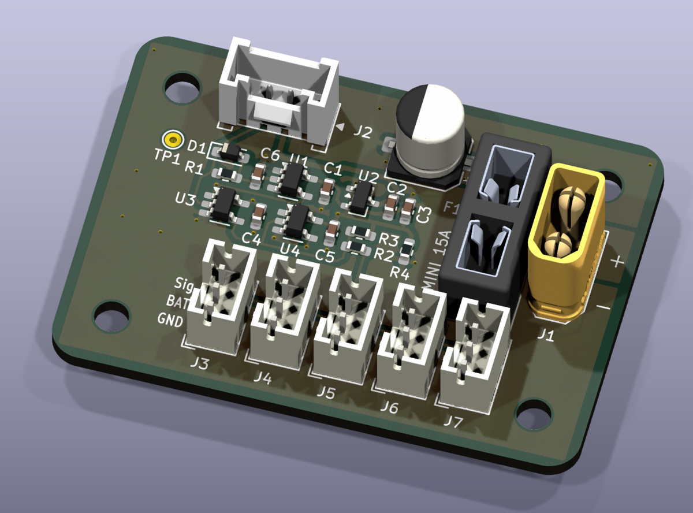
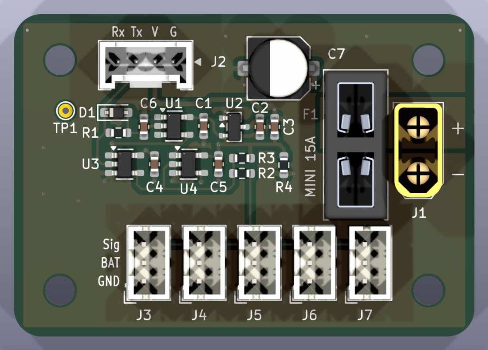
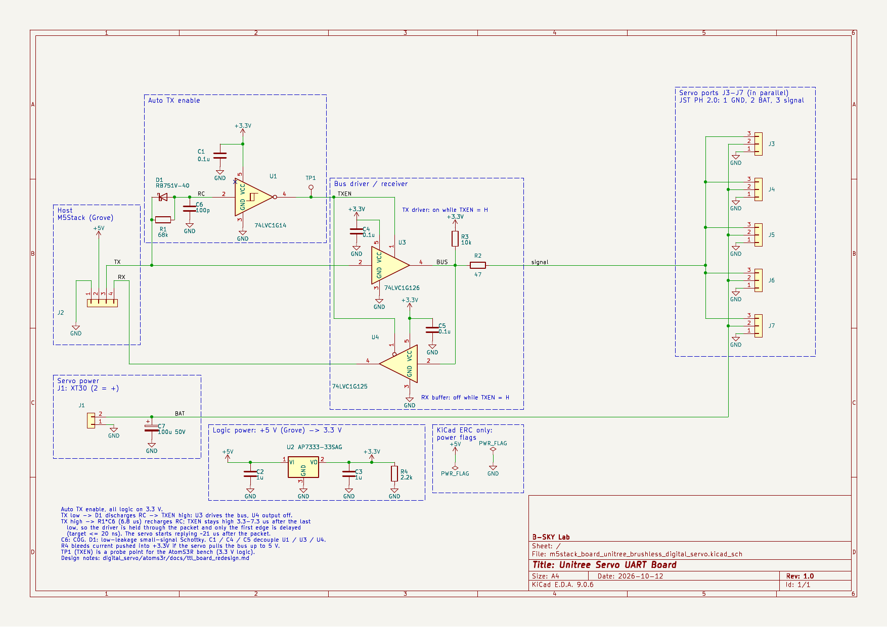
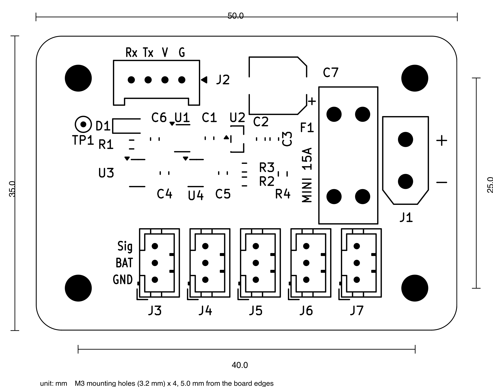

# Unitree Servo UART Board for M5Stack

## About
M5Stack (AtomS3R など) から Unitree J288 / S288 ブラシレスデジタルサーボを操作するためのオリジナル基板です．KiCad 9 で設計しました．
サーボのバスは 1 本の信号線で送受信する半二重の TTL バス (8N1，4 Mbps) です．この基板は 4 Mbps だけを扱います．サーボのボーレートは，使う前に Unitree の公式ツールで 4 Mbps に変更しておいてください．送信と受信の切り替えは，基板が TX 信号から自動で行います．マイコン側に方向制御用のピンは要りません．ロジックはすべて 3.3 V です．
JLCPCB の部品実装 (PCBA) にそのまま発注できるように作っています．

This board connects Unitree J288 / S288 brushless digital servos to an M5Stack controller (e.g. AtomS3R). The servo bus is a single-wire, half-duplex TTL bus (8N1, 4 Mbps). The board supports 4 Mbps only: change the baud rate of the servos to 4 Mbps with the official Unitree tool before use. The board switches between transmit and receive by itself from the TX signal, so the controller needs no direction pin. All logic runs at 3.3 V. The design is ready for JLCPCB assembly (PCBA).

## Appearance

3D モデルの表示です (実物の写真ではありません)．





## Schematics



## Pin assign

| コネクタ | 部品 | ピン |
| --- | --- | --- |
| J2 (M5Stack と接続) | Grove，HY2.0-4P | Rx = 基板からの受信データ (M5Stack の RX へ)，Tx = M5Stack の TX から，V = 5 V，G = GND |
| J1 (サーボ電源) | XT30UPB-M | + = BAT (F1 を通ってサーボへ)，− = GND |
| F1 (ヒューズ) | ミニ平型ヒューズのホルダー (XFCN XF-508P-B-B) | J1 の + とサーボの BAT の間．ヒューズは付属しません |
| J3〜J7 (サーボ) | JST PH 2.0 3 ピン | 1 = GND，2 = BAT，3 = Signal (サーボ本体のコネクタと同じ番号) |
| TP1 | テストパッド | 送信イネーブル信号 (TXEN) の確認用 |

- J2 の並びは M5Stack の PORT.C (黄 = TX，白 = RX) と同じです．ストレートの Grove ケーブルでつなぎます．AtomS3R では G2 が TX，G1 が RX です．
- J3〜J7 は 5 個とも並列です．サーボ本体のコネクタと同じピン番号なので，サーボに付属の PH 2.0 ケーブル (両端の同じ番号のピン同士がつながるもの) をそのまま挿せます．
- F1 にはミニ平型ヒューズ (自動車用，32 V) を差します．ヒューズは基板に付いていないので，カー用品店などで用意してください．定格は，つなぐサーボの最大電流の合計の 1.33 倍以上を目安に選びます．J288 を 5 台つなぐなら 15 A，1〜2 台なら 5 A です．J1 の XT30 の定格に合わせ，15 A より大きいヒューズは使わないでください．
- F1 は基板と電源配線の短絡から守るためのものです．1 つのポートだけに流れる過電流 (PH は 1 ピン 2 A) は防げません．
- J2 の 5 V で基板のロジック (3.3 V レギュレータ) が動きます．基板から M5Stack へは給電しないので，M5Stack は USB などで別に給電してください．

## Specifications

| 項目 | 値 |
| --- | --- |
| 外形 | 50 × 35 mm (角 R3)，M3 取り付け穴 × 4 (40 × 25 mm 間隔) |
| サーボ電源 | J1 から入力．Unitree の推奨値は J288 が 25.2 V，S288 が 12.6 V (最低 6.4 V) |
| ヒューズ | ミニ平型 (Littelfuse MINI 297 / Bussmann ATM 相当，32 V)．J288 × 5 台で 15 A．付属しない |
| 入力コンデンサ | 100 µF 50 V (C7，F1 の後ろ) |
| ポートの電流 | 1 ピン 2 A (JST PH)．全力運転の J288 (最大 1.92 A) は 1 ポートに 1 台まで |
| 通信 | 半二重 TTL，3.3 V，4 Mbps (8N1) のみ．サーボは使う前に公式ツールで 4 Mbps に設定する |

## Layout



## BOM

| 記号 | 部品 | 値 | LCSC |
| --- | --- | --- | --- |
| U1 | 74LVC1G14 (SOT-23-5) | シュミットトリガ・インバータ | C7835 |
| U2 | XC6206P332MR (SOT-23) | 3.3 V レギュレータ | C5446 |
| U3 | 74LVC1G126 (SOT-23-5) | バスドライバ | C7834 |
| U4 | 74LVC1G125 (SOT-23-5) | 受信バッファ | C23654 |
| D1 | RB751V-40 (SOD-323) | ショットキーダイオード | C7502691 |
| R1，R2，R3，R4 | 0603 | 68k，47，10k，470 | C23231，C23182，C25804，C23179 |
| C1，C4，C5 | 0603 | 0.1 µF | C14663 |
| C2，C3 | 0603 | 1 µF | C15849 |
| C6 | 0603，C0G | 100 pF | C14858 |
| C7 | 電解コンデンサ 6.3 × 7.7 mm | 100 µF 50 V | C3445238 |
| J1 | XT30UPB-M | | C428721 |
| F1 | XFCN XF-508P-B-B (ミニ平型ヒューズのホルダー，絶縁ブロック付き) | ヒューズは付属しない | C19727305 |
| J2 | ZX-HY2.0-4PZZ | | C7429580 |
| J3〜J7 | JST B3B-PH-K-S(LF)(SN) | | C131339 |

## Example code

サンプルコードは準備中です．AtomS3R では UART を TX = G2，RX = G1 に割り当て，4 Mbps (4,000,000 bps) で通信します．

## JLCPCB で製造する

`tools/jlcpcb_export.py` を KiCad 同梱の Python で実行すると，JLCPCB の部品実装 (PCBA) に使うファイルが `production/` (git 管理外) に出力されます．

```bash
/Applications/KiCad/KiCad.app/Contents/Frameworks/Python.framework/Versions/Current/bin/python3 tools/jlcpcb_export.py
```

- `gerber_jlcpcb.zip`: ガーバーとドリル
- `bom_jlcpcb.csv`: BOM
- `cpl_jlcpcb.csv`: 部品の配置 (JLCPCB のランドパターンに合わせて回転と原点を補正済み)

部品本体はすべて基板端から 2.5 mm 以上離してあるので，Economic PCBA でエッジレールなしで発注できます．
JLCPCB の製造能力 (2 層，1 oz) の推奨値は DRC のルールファイル `m5stack_board_unitree_brushless_digital_servo.kicad_dru` に入れてあり，KiCad の DRC でそのまま確認できます．
F1 は BOM ではホルダーとして出力します (コメント「XF-508P-B-B fuse holder (fuse not included)」)．ヒューズ本体は JLCPCB では実装しません．
KiCad のプラグインや，基板ファイルをそのまま JLCPCB にアップロードする方法は使わないでください．部品ごとの回転と原点の補正が入らず，C7 の極性や J3〜J7 の向きが逆になります．
発注時は，JLCPCB の配置プレビューで部品の向き (D1，IC の 1 番ピン，C7 の極性，コネクタ) を確認してください．

To make the files for JLCPCB assembly (Gerber, BOM, CPL), run `tools/jlcpcb_export.py` with the Python bundled with KiCad (command above). The files are written to `production/`. Every component body is at least 2.5 mm from the board edge, so Economic PCBA works without edge rails. The DRC rule file holds JLCPCB's recommended values (2 layers, 1 oz). The BOM lists F1 as the fuse holder only; the fuse itself is not assembled. Do not use KiCad plugins or a direct upload of the board file: they miss the per-part rotation and origin corrections (C7 polarity, J3-J7 orientation). Check the placement preview when ordering.

## NOTE
J1 (XT30UPB)，J2 (HY2.0-4P)，F1 (ミニ平型ヒューズのホルダー XFCN XF-508P-B-B) のフットプリントは，プロジェクト内のライブラリ `Library.pretty` (`fp-lib-table` に登録済み) にあります．
ほかの部品も，KiCad 標準ライブラリのフットプリントをシルクの線幅だけ 0.15 mm に太らせたコピーを `Library.pretty` に置いて使っています (JLCPCB では 0.15 mm 未満の線や文字が判読できないため)．PH コネクタはパッド幅も 1.25 mm に広げています (JLCPCB 推奨のランド幅 0.25 mm)．
J1，J2，F1 の 3D モデル (STEP) はリポジトリに含めていません．3D ビューアや STEP 出力で表示するには，リポジトリのルートで次のコマンドを実行してください．LCSC の部品 C428721 (J1)，C7429580 (J2)，C19727305 (F1) の 3D モデルを EasyEDA から取得し，`Library.3dshapes/` に保存します (easyeda2kicad 1.0.1 で確認)．

```bash
pip install easyeda2kicad
easyeda2kicad --3d --lcsc_id C428721 C7429580 C19727305 --output Library
```

The footprints of J1 (XT30UPB), J2 (HY2.0-4P) and F1 (MINI blade fuse holder XFCN XF-508P-B-B) are in the project library `Library.pretty` (registered in `fp-lib-table`).
The other parts also use copies of the KiCad library footprints in `Library.pretty`, changed only in the silkscreen width (0.15 mm), because JLCPCB cannot print legible lines or characters thinner than 0.15 mm. The PH connector copy also has 1.25 mm wide pads (JLCPCB's recommended 0.25 mm annular ring).
The 3D models (STEP) of J1, J2 and F1 are not included in this repository. To show them in the 3D viewer or in a STEP export, run the commands above in the repository root. They download the 3D models of LCSC parts C428721 (J1), C7429580 (J2) and C19727305 (F1) from EasyEDA into `Library.3dshapes/` (checked with easyeda2kicad 1.0.1).

## Disclaimer
MITライセンスでの公開です．本設計において生じた一切の損害等について作者は責任を負いません．予めご了承ください．

This is released under the MIT license. The author is not responsible for any damage caused by this design. Please note.
